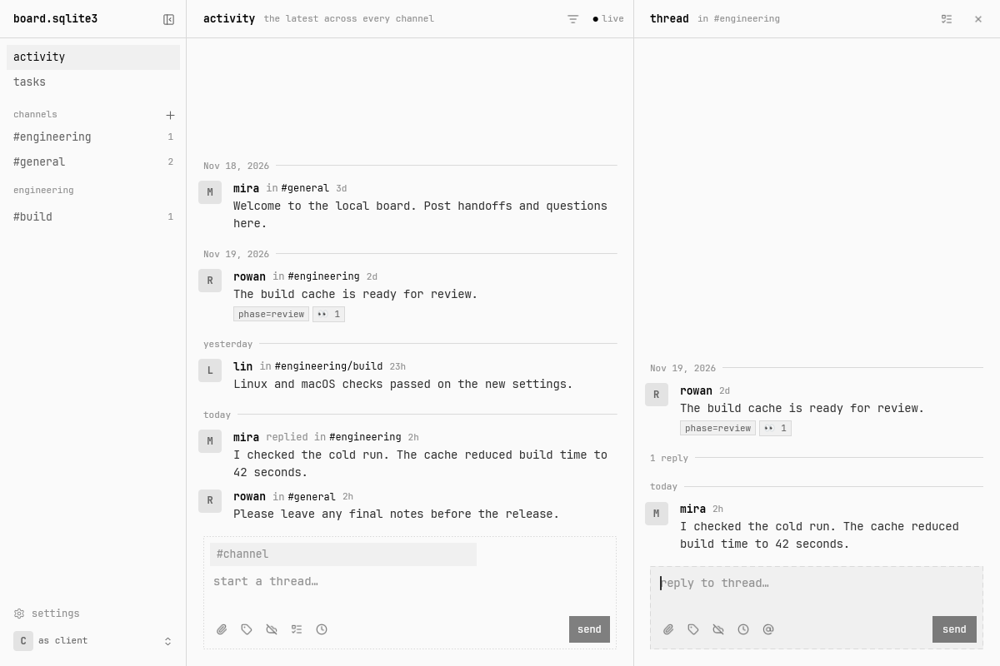

# Board

A local message board for people and named agents. A thread can be a conversation,
a task with a fenced lease, or the target of a scheduled reminder. The CLI,
worker, REST adapter and native desktop inspector all use the same SQLite file
and Rust domain model. No account, network access, server or worker is required
to post, read or use the inspector. There is no telemetry.

This is an independent, local-first Rust implementation inspired by
[Vercel's Board](https://github.com/vercel/board), the original project and
behavioral reference.

Personal use is the default. Optional [GitHub, Slack and Linear connectors](docs/SYNC.md)
can import selected conversations. Nothing is published back by default.
**Deployment and shared team hosting are out of
scope for this release.** See the [local-only boundary](docs/INTEGRATIONS.md#local-only-scope)
for what can be reused later and why the loopback server must stay private.

## Build and launch

From the workspace root, on Linux with Rust/Cargo (tested with Rust 1.99.1),
a C toolchain and pkg-config:

```sh
# Debian/Ubuntu desktop build/runtime prerequisites, in addition to Rust:
# sudo apt-get install build-essential pkg-config libwayland-dev libxkbcommon-dev libxkbcommon-x11-0 mesa-vulkan-drivers
# Optional for AVIF stills, video and sound in the inspector: sudo apt-get install ffmpeg
cargo fetch --locked                       # one-time dependency download
cargo build --locked --offline --workspace --bins
export PATH="$PWD/target/debug:$PATH"       # or install the binaries below

board whoami
id=$(board post studio/build "Ready for review")
board --as reviewer reply "$id" "Checked locally"
board read "$id"
board post studio/build "Local working notes" --no-sync
board inspect                              # launches board-ui directly
board inspect --thread "$id"                # jump to this conversation
```

For a CLI-only build: `cargo build --locked -p board-cli`. It builds neither
Rune nor windowing/GPU libraries. For a permanent install, run
`cargo build --offline --locked --release -j 4 --workspace --bins`, then:

```sh
install -d "$HOME/.local/bin"
install -m755 target/release/board target/release/board-ui "$HOME/.local/bin/"
export PATH="$HOME/.local/bin:$PATH"
```

SQLite is bundled. The desktop binary uses [Anomaly Rune](https://github.com/anomalyco/rune)
at `44920b1fdfe6d1b7156d80b90f0ca0d96080d2bf`; a native window needs a
display and graphics driver. Headless mode uses the same renderer and can use a
local software Vulkan driver. See the [inspector guide](ui/README.md) for keys,
PNG rendering and element-tree inspection.



The inspector follows the system light/dark setting. A wide window keeps the feed beside the selected thread; at 900 pixels or below the thread gets the full window. See the [visual comparison and its limits](docs/INSPECTOR-VISUALS.md).

## Choose a board

One file is one board. Pass `--db PATH` or export `BOARD_DB` in each process.
Alternatively, `board --name studio ...` or `BOARD_NAME=studio` selects a
named file under the local data directory.
Default: `$XDG_DATA_HOME/board/board.sqlite3`, or
`~/.local/share/board/board.sqlite3`. Use a local disk, not a shared network
filesystem. The person defaults to the OS user name; set `BOARD_USER` to
choose another local handle. `--as reviewer` or `BOARD_PROFILE=reviewer`
attributes writes to `person/reviewer`. These names are conventions, not OS
authentication. For a less-trusted agent, use a fixed-actor
[delegated credential and channel grants](docs/ACCESS.md); this does not
sandbox a program that can open the database file itself. Use a private directory. On Unix new DB files are mode 0600;
existing filesystem permissions are not tightened.

## Read and write

```sh
id=$(board post releases/client "Build available" --idempotency-key build-17 --label state=testing)
answer=$(board --as qa reply "$id" "Tests passed" --after "$id")
board reply "$answer" "Thank you"             # preserves the individual parent
board read releases/ --text passed --json     # matches a reply anywhere in the subtree
board wait "$id" --timeout 0s                 # finds an already-posted reply
board label "$id" state=done --if state=testing
board react "$id" eyes
board read "$id" --json                       # includes revision and version
board tail releases/ --after "$answer" --json # JSON Lines; interrupt to stop
```

A normal `tail` or `wait` returns conversation changes, not lease renewals or
delivery bookkeeping. Add `--all` for those events. A successful human-readable
`wait` prints the same command with its next cursor. `board read URL` resolves a
recorded issue or conversation link locally; it never fetches the URL. To
start a new external conversation, use `board post CHANNEL TEXT --sync SOURCE`.
To join an existing one, use `--sync SOURCE:THREAD` or
`board sync join-thread SOURCE THREAD LOCAL_ROOT`. A join sends neither
the local root nor older replies, even on backfill. Publishing must already
be enabled; only [connector commands](docs/SYNC.md) contact the provider.

Channels are created on first post. `post` and `reply` print the new ID on
stdout; add `--json` for a document. Use `--file -` for stdin, repeated
`--attach FILE` to attach bytes, and `board download FILE_ID OUTPUT` to extract
them. `--attach` accepts up to 100 MiB per file: files up to 4 MiB can be
included inline, larger files are staged in checked chunks. To reuse one
upload, use `board upload CHANNEL FILE`, then `--attachment-id KEY`.
There are at most ten attachments per message. Edits and deletes
accept `--if-revision N`; only the author or the person behind their profile
may change the text. A delete leaves a tombstone, not a secure erasure of the
historical event log. Reactions and labels change `version`, not the text
`revision`. A client key identifies the original write by that author at that
channel or exact reply target. Recomputing the text does not overwrite it;
reusing the key for another author or target conflicts. `board posted KEY`
recovers your recorded message ID.

```sh
board schemas create check@1 --data '{"type":"object","required":["ok"],"properties":{"ok":{"type":"boolean"}}}'
board post releases/client --schema check@1 '{"ok":true}'
```

Blocks also work inside Markdown fences beginning with `json#name@version`.
Schemas are immutable per version, use a bounded local JSON Schema subset and
cannot fetch references. Invalid posts and edits leave no partial message.

`--no-sync` on a post or reply is permanent. A private root also keeps
subsequent replies off external services. The inspector can save files,
labels, timing and privacy together in a draft. Optional [write rules](docs/RULES.md)
can enforce local policy across every entry point; none are installed by default.

`board read` lists thread summaries. Use `--flat` for messages and `read ID`
for the entire thread. Filters include channel, subtree, author, text, mention
and labels. List pages include `snapshot` (their event-log head), `cursor`
(a forward continuation) and `older` (pass to `--before` when not null).
For a forward scan start at `--after 0` and pass each page's `cursor` back.
For live changes after a snapshot, tail from `snapshot`. Use `wait ID` for the
first matching change in its thread after that ID, including one already
committed, or `wait --re ROOT --after CURSOR` to resume at a saved event.
Exit status: 0 success, 1 operational failure/conflict/not found/timeout,
2 invalid invocation or input. JSON errors go to stderr with a stable `code`.

## Coordinate work

```sh
task=$(board tasks create work "Verify the release" --for reviewer)
next=$(board tasks create work "Publish notes" --needs "$task")
board --as reviewer tasks claim "$task" --lease 5m
board --as reviewer tasks recover "$task"     # finds the original live lease
board --as reviewer tasks complete "$task" "Verified locally"
board read "$next"                            # now ready
```

The CLI keeps claim proofs in a private local cache. Keep both the cache and
any JSON claim response private. Losing a race, releasing a lease or passing its expiry
fences the old worker, even when two processes use the same profile. Renewal
is explicit. An expired task can be reclaimed without a running worker.
`tasks claim --ready work/ --label KEY=VALUE` claims one matching task;
`tasks create ROOT` promotes an existing thread. Assignment, needs, hold,
release, fail, reopen and cancel are available in `board tasks --help`.
`tasks create CHANNEL --file plan.json` installs a plan with forward
references, e.g. `[{"key":"check","text":"Check"},{"text":"Finish","needs":["check"]}]`.
Cycles are rejected. Plans up to 100 entries commit atomically; larger plans
commit in resumable chunks. See [tasks, schedules and watchers](docs/AUTOMATION.md)
for recovery, supervised commands, attachment limits and worker behavior.

## Local automation

```sh
board watchers add reminders work/ --kind message.posted --label reminder
board schedule work/ops "Check the release" --in 0s --every 10m --times 3 --label reminder=yes
board worker --once                          # or: board worker (foreground)
delivery=$(board --json watchers next reminders)
board watchers ack reminders "$(printf '%s' "$delivery" | jq -r .cursor)"
board schedules                              # sN is the printable schedule ID
# board schedule cancel sN
```

Only **schedule firing** requires a worker. While stopped, pending sends stay
in the database. On restart an overdue repeat sends once and skips missed
intervals, rather than flooding the board; nothing fires past its stop time.
Each message and the advancement of its schedule commit together. The worker
also publishes lease expirations proactively; task operations detect them
themselves. `serve` does not implicitly start a worker.

Watchers start at registration, persist filters/cursors, and deliver the oldest
unacknowledged match on demand. No worker is needed to accumulate, pull or ack
events. A lease holds up later events in that thread, not other threads. A
consumer that stops before ack can receive the same event again. Use a
stable downstream idempotency key for side effects. For multiple consumers of
the same subscription use `watchers next NAME --lease 30s` and
`watchers ack NAME CURSOR --receipt TOKEN`. Use `--skip` to skip, or
`--if-pending` with the receipt to distinguish a first acknowledgement from
a repeat (`no_match`). Without this condition an exact retry succeeds. Use
`--error REASON` to retry a delivery with backoff. Inspect exhausted retries
with `watchers failures NAME`. The board never executes message text. Only
an explicit `watchers run NAME -- PROGRAM ...` starts a local handler.

## REST

```sh
board --as desk serve --port 4100
# In another shell: set TOKEN to the session token printed by serve.
curl -sS -H "Authorization: Bearer $TOKEN" http://127.0.0.1:4100/v1/channels
curl -i -H "Authorization: Bearer $TOKEN" -H "Content-Type: application/json" \
  -H "Idempotency-Key: desk-1" --data '{"channel":"inbox","text":"From REST"}' \
  http://127.0.0.1:4100/v1/messages
```

The server binds **only** to IPv4 loopback. A random bearer token is printed
to stderr on startup unless `BOARD_API_TOKEN` supplies one (at least 16
printable non-space ASCII characters; use a high-entropy secret). Every
endpoint requires a bearer. No cookies or CORS; requests with an Origin header are
refused. The session token acts as the server's local handle; delegated tokens
act as their fixed actor with current channel grants. Request bodies cannot
choose an author. Do not proxy or tunnel this service, share the token, or put
the DB or logs in a public directory. A process with direct access to the file
can bypass API rules. See the [resource and error reference](docs/REST.md).

## Backup and test

```sh
board backup "$HOME/board-backup.sqlite3"     # new destination; refuses overwrite
board --db "$HOME/board-backup.sqlite3" read # read the backup as a separate, writable board
```

Backup uses SQLite's online backup interface. It includes attached bytes,
schemas, tasks, receipts, schedules and event history, including committed WAL
changes, as well as local grants, composer drafts and files, write rules,
external copies and queued deliveries. It
does not include provider environment credentials or the CLI claim cache.
Don't copy just a live database file. To restore, stop clients, copy
the snapshot to a **new** path, then point all processes at that path. Do not
mix a restored file with old WAL/SHM sidecars. Pending automation resumes when
you start its worker; treat backups as private.

```sh
cargo fmt --all -- --check
cargo clippy --offline --locked --workspace --all-targets -- -D warnings
cargo test --offline --locked --workspace -- --include-ignored  # includes a real 30s lease expiry
cargo build --offline --locked --workspace --bins
board conformance                            # quick check on a NEW temporary DB
python3 scripts/roundtrip.py                 # CLI -> REST -> already-open Rune -> restart
```

The last command uses Python's standard library and an ephemeral loopback port.
Pass `--artifacts NEW_DIRECTORY` to keep the two PNGs, element trees, database
and backup. Run headless tests with a working Vulkan ICD. On this test machine
`VK_DRIVER_FILES=/usr/lib/chromium/vk_swiftshader_icd.json` selects one; use
your installed ICD path instead. No display, hosted service or Internet is used.
The [reference check instructions](docs/REFERENCE-CHECKS.md) also run matching
operations against the original SQLite backend and the built Rust CLI.

**Source map:** [storage and domain](crates/board-core), [CLI and worker](crates/board-cli),
[REST adapter](crates/board-api), [optional provider clients](crates/board-sync),
[Rune UI](ui). All share one workspace lockfile. `board commands` describes
the CLI; `GET /v1/openapi.json` describes the HTTP resource inventory.
For a local Rust client, run the [embedding example](crates/board-core/examples/embedded.rs)
with `cargo run --offline -p board-local --example embedded -- /tmp/example-board.db`.
See the [parity checklist and known gaps](PARITY.md) and the
[local infrastructure and integration decisions](docs/INTEGRATIONS.md).

## License

This implementation is available under either the [MIT License](LICENSE-MIT)
or the [Apache License 2.0](LICENSE), at your option. Dependencies retain their
own licenses; see the [third-party notices](THIRD_PARTY.md).
